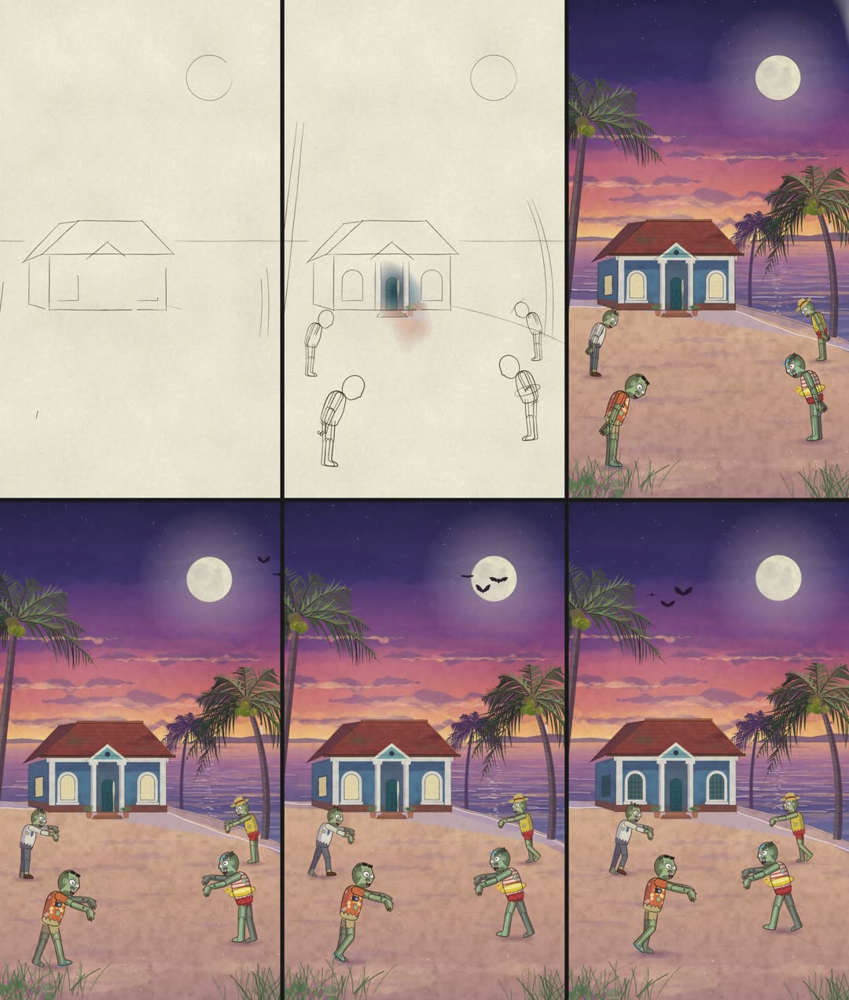

# claude-draws

A Claude Code skill that turns one sentence into a short hand-painted animation.

You type something like **"a house on a beach with zombies in it"**. Claude draws every frame
with code: ink lines that draw themselves on cream paper, watercolour washes that spread in, then
the scene comes alive. No After Effects, no AI image generator, no stock footage. If you want music,
Claude also composes a film score note by note in code, played by recordings of real orchestra
instruments.



## Quick start

1. **Install the skill** (see below).
2. **Open Claude Code and type:**
   `/claude-draws a house on a beach with zombies in it, 6 seconds, vertical`
3. **Wait, look at the frames, ask for changes.** Claude shows you snapshots and the video.
   Say what you want different ("make the zombies bigger", "make it night") and it changes that one thing.

## Install

You need [Claude Code](https://claude.com/claude-code), [Node.js](https://nodejs.org) (free) and
ffmpeg. The videos are made with [HyperFrames](https://hyperframes.heygen.com) (free, open source),
which downloads itself the first time.

**Option A: copy it**

Download this repo and copy the `claude-draws` folder into your Claude skills folder:

```
~/.claude/skills/claude-draws
```

**Option B: clone it** (easier to update later)

```bash
git clone https://github.com/Sahiljamnani24/claude-draws.git ~/claude-draws-skill
ln -s ~/claude-draws-skill/claude-draws ~/.claude/skills/claude-draws
```

Restart Claude Code. Type `/claude-draws` to check it is there.

**For music (optional):** Python 3 with numpy and scipy (`pip install numpy scipy`), and the free
orchestra samples VSCO 2 Community Edition (public domain):

```bash
git clone https://github.com/sgossner/VSCO-2-CE.git ~/music-samples/VSCO-2-CE
```

## Ideas to try

- `/claude-draws a house on a beach with zombies in it, 6 seconds, vertical`
- `/claude-draws a house on a beach with zombies in it, la la la la la` (they sing)
- `/claude-draws a cat riding a scooter through monsoon rain in Goa`
- `/claude-draws a fisherman's boat under a giant full moon, fireflies over the water, with music`
- `/claude-draws my grandmother's kitchen on a rainy morning, Ghibli style`

## Good to know

- **It improves in rounds.** The quality comes from Claude looking at its own frames, listing
  what is wrong and fixing it, a few times over. Ask it to "check the frames again" any time.
- **Characters are cut-out puppets**: painted body parts that move at the joints. They read well
  on a phone. They will not move like a hand-animated film.
- **Short is better.** 3 to 10 seconds of one scene looks better than a long story.
- **On a 16 GB laptop** keep other heavy apps closed while it renders. The skill already renders
  with low-memory settings.

## What's inside

```
claude-draws/
  SKILL.md                      the workflow Claude follows
  references/                   how professionals paint this look, characters, the self-check loop, music
  templates/
    index.html                  the video starter (HyperFrames)
    js/engine.js                watercolour washes, ink lines, paper
    js/scene.js                 example scene: a Goan beach house at dusk
    js/palms.js, js/figures.js  palm trees, cut-out characters with walk cycles
    examples/zombies.js         the zombie cast from the demo
    examples/zombies_lalala.js  the same zombies singing "la la la"
    audio/make_score.py         composes a score from a cue list, plays it with real samples, checks the mix
    tools/contact_sheet.sh      a 6-frame overview of any video
```

## More free skills to try

Want a different look? These are other free, open-source skills and tools people have made for drawing
and animating with Claude. Pick the one that fits your idea.

| Skill | What it's good at | Licence |
|---|---|---|
| [cloveric/claude-drawing-skill](https://github.com/cloveric/claude-drawing-skill) | 70 illustration styles drawn with code: ink wash, ukiyo-e, linocut, stained glass, paper collage, gouache... (draw-on GIFs) | MIT |
| [cth9191/animate](https://github.com/cth9191/animate) | Short animations in any style (cut paper, crosshatch, riso), with story and storyboard check-ins, beat-mapped to your music | MIT |
| [JohnHeibel/ClaudeAnimationBase](https://github.com/JohnHeibel/ClaudeAnimationBase) | Hand-painted cartoon characters with p5.js + p5.brush, 31 acted emotions | MIT |
| [anthropics/skills](https://github.com/anthropics/skills) | Anthropic's own example skills, e.g. `algorithmic-art` (generative art with p5.js), `canvas-design` (posters and art), `slack-gif-creator` (animated GIFs) | Apache 2.0 |
| [heygen-com/hyperframes](https://github.com/heygen-com/hyperframes) | The video engine this skill renders with: turn HTML into MP4, with its own skills for motion graphics and captions | Apache 2.0 |
| [awesome-claude-video-skills](https://github.com/zhuyansen/awesome-claude-video-skills) | A big list of 180 open-source video skills for Claude Code and other agents, sorted by type | list |

## Credits

Made by [@thatsahil.24](https://www.instagram.com/thatsahil.24/).
Videos rendered with [HyperFrames](https://hyperframes.heygen.com) by HeyGen.
Instrument samples: VSCO 2 Community Edition by Versilian Studios (CC0).
Watercolour wash method inspired by Tyler Hobbs' generative watercolour essay.

License: MIT (see `LICENSE`).
